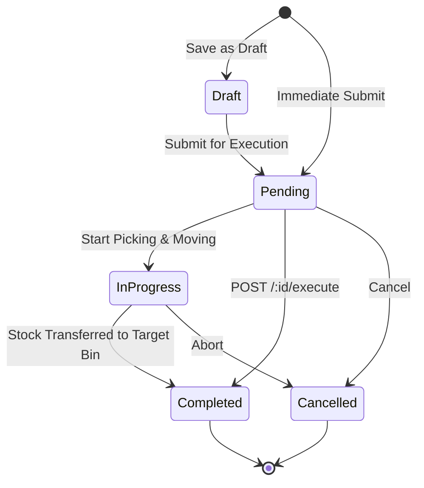
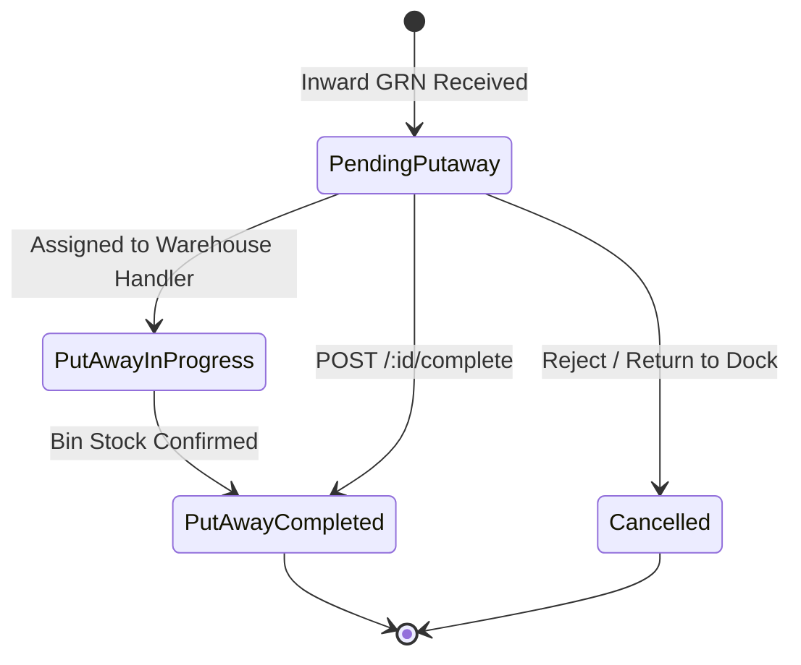

# Move Orders & Putaways & Storage API Specification

This document provides a comprehensive end-to-end API specification for **Move Orders** (Intra-warehouse / Bin-to-Bin stock movements) and **Putaways & Storage** (Dock-to-Rack inbound receiving and bin allocations).

---

## 1. Authentication & Common Headers

All endpoints require JWT Bearer Authentication and Multi-tenant organization scoping.

### Headers
| Header | Type | Required | Description | Example |
| :--- | :--- | :--- | :--- | :--- |
| `Authorization` | `string` | **Yes** | Standard JWT Bearer token | `Bearer eyJhbGciOi...` |
| `Content-Type` | `string` | **Yes** | Content encoding type | `application/json` |

---

## 2. Base Endpoints Overview

| Module | Route Prefix | Alternate / Alias Prefix |
| :--- | :--- | :--- |
| **Move Orders** | `/api/v1/inventory/inventory/move-orders` | `/api/v1/inventory/move-orders` |
| **Putaways & Storage** | `/api/v1/inventory/inventory/putaways` | `/api/v1/inventory/putaways` |

---

## 3. Move Orders API Specification

Move Orders manage the scheduled or ad-hoc movement of stock from one warehouse/bin to another (e.g. Replenishment, Staging, QA relocation, Defective quarantine).

### 3.1. List Move Orders
- **Method**: `GET`
- **URL**: `/api/v1/inventory/inventory/move-orders`
- **Query Parameters**:
  | Parameter | Type | Required | Default | Description |
  | :--- | :--- | :--- | :--- | :--- |
  | `status` | `string` | No | - | Filter by status: `Draft`, `Pending`, `In Progress`, `Completed`, `Cancelled` |
  | `warehouseId` | `string` | No | - | Filter by Source or Destination Warehouse Mongo ObjectId |
  | `search` | `string` | No | - | Case-insensitive search on `moveOrderNumber` or `reason` |
  | `page` | `number` | No | `1` | Pagination page number |
  | `limit` | `number` | No | `50` | Number of records per page |

#### Response (`200 OK`)
```json
{
  "success": true,
  "count": 1,
  "total": 1,
  "data": [
    {
      "_id": "673f1d248b9f4a123456789a",
      "orgId": "6aa797278d301b4735f1d322",
      "moveOrderNumber": "MO-00001",
      "orderDate": "2026-10-22T00:00:00.000Z",
      "expectedDate": "2026-10-23T00:00:00.000Z",
      "sourceWarehouse": "Main Central Warehouse",
      "destinationWarehouse": "North Regional Hub",
      "reason": "Replenishment",
      "items": [
        {
          "name": "Brake Rotor Disc - Type A",
          "sku": "BRK-ROT-001",
          "quantity": 25,
          "fromBin": "BIN-A-01",
          "toBin": "BIN-R-12",
          "batchNumber": "BATCH-2026-X1"
        }
      ],
      "status": "Pending",
      "notes": "Urgent inter-bin restock",
      "createdAt": "2026-10-22T06:55:00.000Z",
      "updatedAt": "2026-10-22T06:55:00.000Z"
    }
  ]
}
```

---

### 3.2. Get Move Order by ID
- **Method**: `GET`
- **URL**: `/api/v1/inventory/inventory/move-orders/:id`
- **URL Parameters**:
  | Parameter | Type | Description |
  | :--- | :--- | :--- |
  | `id` | `string` | MongoDB `_id` of the Move Order |

#### Response (`200 OK`)
```json
{
  "success": true,
  "data": {
    "_id": "673f1d248b9f4a123456789a",
    "orgId": "6aa797278d301b4735f1d322",
    "moveOrderNumber": "MO-00001",
    "orderDate": "2026-10-22T00:00:00.000Z",
    "expectedDate": "2026-10-23T00:00:00.000Z",
    "sourceWarehouse": "Main Central Warehouse",
    "destinationWarehouse": "North Regional Hub",
    "reason": "Replenishment",
    "items": [
      {
        "name": "Brake Rotor Disc - Type A",
        "sku": "BRK-ROT-001",
        "quantity": 25,
        "fromBin": "BIN-A-01",
        "toBin": "BIN-R-12",
        "batchNumber": "BATCH-2026-X1"
      }
    ],
    "status": "Pending",
    "notes": "Urgent inter-bin restock"
  }
}
```

---

### 3.3. Create Move Order
- **Method**: `POST`
- **URL**: `/api/v1/inventory/inventory/move-orders`
- **Request Body**:
  | Field | Type | Required | Description |
  | :--- | :--- | :--- | :--- |
  | `moveOrderNumber` | `string` | No | Auto-generated (`MO-XXXXX`) if omitted |
  | `sourceWarehouse` | `string` | **Yes** | Source warehouse name or ID |
  | `destinationWarehouse` | `string` | **Yes** | Destination warehouse name or ID |
  | `orderDate` | `string (ISO)` | No | Order date (Default: `Date.now()`) |
  | `expectedDate` | `string (ISO)` | No | Expected completion date |
  | `reason` | `string` | No | Movement reason (`Replenishment`, `Reorganization`, `Damaged Goods Quarantine`, etc.) |
  | `items` | `Array<Object>` | **Yes** | Array of items to be transferred |
  | `items[].itemId` | `string` | No | Optional Item MongoDB ObjectId |
  | `items[].name` | `string` | **Yes** | Item Name |
  | `items[].sku` | `string` | No | Item SKU |
  | `items[].quantity` | `number` | **Yes** | Quantity to move |
  | `items[].fromBin` | `string` | No | Origin bin rack identifier |
  | `items[].toBin` | `string` | No | Destination bin rack identifier |
  | `items[].batchNumber`| `string` | No | Lot / Batch number |
  | `items[].serialNumbers`| `string[]` | No | Specific serial numbers |
  | `notes` | `string` | No | Internal remarks |

#### Request Payload Example
```json
{
  "sourceWarehouse": "Main Central Warehouse",
  "destinationWarehouse": "North Regional Hub",
  "reason": "Replenishment",
  "expectedDate": "2026-10-23T00:00:00.000Z",
  "items": [
    {
      "name": "Brake Rotor Disc - Type A",
      "sku": "BRK-ROT-001",
      "quantity": 25,
      "fromBin": "BIN-A-01",
      "toBin": "BIN-R-12",
      "batchNumber": "BATCH-2026-X1"
    }
  ],
  "notes": "Urgent inter-bin restock"
}
```

#### Response (`201 Created`)
```json
{
  "success": true,
  "data": {
    "_id": "673f1d248b9f4a123456789a",
    "orgId": "6aa797278d301b4735f1d322",
    "moveOrderNumber": "MO-00001",
    "orderDate": "2026-10-22T06:55:00.000Z",
    "expectedDate": "2026-10-23T00:00:00.000Z",
    "sourceWarehouse": "Main Central Warehouse",
    "destinationWarehouse": "North Regional Hub",
    "reason": "Replenishment",
    "items": [
      {
        "name": "Brake Rotor Disc - Type A",
        "sku": "BRK-ROT-001",
        "quantity": 25,
        "fromBin": "BIN-A-01",
        "toBin": "BIN-R-12",
        "batchNumber": "BATCH-2026-X1"
      }
    ],
    "status": "Pending",
    "notes": "Urgent inter-bin restock",
    "createdAt": "2026-10-22T06:55:00.000Z",
    "updatedAt": "2026-10-22T06:55:00.000Z"
  }
}
```

---

### 3.4. Execute Move Order
Marks the move order as completed and executes physical bin stock redistribution.
- **Method**: `POST`
- **URL**: `/api/v1/inventory/inventory/move-orders/:id/execute`
- **Payload**: None required (empty body `{}`)

#### Response (`200 OK`)
```json
{
  "success": true,
  "message": "Move order executed successfully",
  "data": {
    "_id": "673f1d248b9f4a123456789a",
    "moveOrderNumber": "MO-00001",
    "status": "Completed",
    "updatedAt": "2026-10-22T06:56:15.000Z"
  }
}
```

---

### 3.5. Update Move Order
- **Method**: `PUT`
- **URL**: `/api/v1/inventory/inventory/move-orders/:id`
- **Request Body**: Any valid fields from MoveOrder schema.

---

### 3.6. Delete Move Order
- **Method**: `DELETE`
- **URL**: `/api/v1/inventory/inventory/move-orders/:id`

#### Response (`200 OK`)
```json
{
  "success": true,
  "message": "Move order removed"
}
```

---

## 4. Putaways & Storage API Specification

Putaway operations control inbound materials arriving from Purchase Orders / Inward Receipts (GRN) at the receiving dock, routing them into designated warehouse bins, shelves, and racks.

### 4.1. List Putaways
- **Method**: `GET`
- **URL**: `/api/v1/inventory/inventory/putaways`
- **Query Parameters**:
  | Parameter | Type | Required | Description |
  | :--- | :--- | :--- | :--- |
  | `status` | `string` | No | Filter by: `Pending Putaway`, `Put Away In Progress`, `Put Away Completed`, `Cancelled` |
  | `warehouseId` | `string` | No | Warehouse filter |
  | `search` | `string` | No | Search on `putawayNumber`, `vendor`, `sourceDockLocation`, `destinationBin` |
  | `page` | `number` | No | Page number (Default: `1`) |
  | `limit` | `number` | No | Page size (Default: `50`) |

#### Response (`200 OK`)
```json
{
  "success": true,
  "count": 1,
  "total": 1,
  "data": [
    {
      "_id": "673f1d248b9f4a123456789b",
      "orgId": "6aa797278d301b4735f1d322",
      "putawayNumber": "PW-00001",
      "grnNumber": "GRN-2026-8801",
      "vendor": "Bosch Automotive Parts Ltd",
      "warehouse": "Main Central Warehouse",
      "sourceDockLocation": "Dock-01 Inbound Bay",
      "destinationBin": "RACK-B-BIN-04",
      "items": [
        {
          "name": "Fuel Injector Assembly",
          "sku": "BOSCH-FI-882",
          "receivedQuantity": 50,
          "putawayQuantity": 50,
          "batchNumber": "BATCH-2026-INJ-01",
          "expiryDate": "2029-10-22T00:00:00.000Z"
        }
      ],
      "putawayDate": "2026-10-22T06:55:00.000Z",
      "status": "Pending Putaway",
      "notes": "Direct dock-to-rack putaway assignment",
      "createdAt": "2026-10-22T06:55:00.000Z",
      "updatedAt": "2026-10-22T06:55:00.000Z"
    }
  ]
}
```

---

### 4.2. Get Putaway by ID
- **Method**: `GET`
- **URL**: `/api/v1/inventory/inventory/putaways/:id`

#### Response (`200 OK`)
```json
{
  "success": true,
  "data": {
    "_id": "673f1d248b9f4a123456789b",
    "putawayNumber": "PW-00001",
    "grnNumber": "GRN-2026-8801",
    "vendor": "Bosch Automotive Parts Ltd",
    "warehouse": "Main Central Warehouse",
    "sourceDockLocation": "Dock-01 Inbound Bay",
    "destinationBin": "RACK-B-BIN-04",
    "items": [
      {
        "name": "Fuel Injector Assembly",
        "sku": "BOSCH-FI-882",
        "receivedQuantity": 50,
        "putawayQuantity": 50,
        "batchNumber": "BATCH-2026-INJ-01",
        "expiryDate": "2029-10-22T00:00:00.000Z"
      }
    ],
    "status": "Pending Putaway"
  }
}
```

---

### 4.3. Create Putaway
- **Method**: `POST`
- **URL**: `/api/v1/inventory/inventory/putaways`
- **Request Body**:
  | Field | Type | Required | Description |
  | :--- | :--- | :--- | :--- |
  | `putawayNumber` | `string` | No | Auto-generated (`PW-XXXXX`) if omitted |
  | `grnNumber` | `string` | No | Goods Receipt Note reference |
  | `vendor` | `string` | No | Origin Vendor / Supplier |
  | `warehouse` | `string` | **Yes** | Destination Warehouse |
  | `sourceDockLocation` | `string` | No | Receiving dock area (e.g. `Dock-01 Inbound Bay`) |
  | `destinationBin` | `string` | **Yes** | Target shelf/bin (e.g. `RACK-B-BIN-04`) |
  | `putawayDate` | `string (ISO)` | No | Timestamp of operation (Default: `Date.now()`) |
  | `items` | `Array<Object>` | **Yes** | Items being put into storage |
  | `items[].itemId` | `string` | No | Item ObjectId |
  | `items[].name` | `string` | **Yes** | Item Name |
  | `items[].sku` | `string` | No | Item SKU |
  | `items[].receivedQuantity` | `number` | **Yes** | Quantity received at dock |
  | `items[].putawayQuantity` | `number` | **Yes** | Quantity transferred into bin |
  | `items[].batchNumber` | `string` | No | Batch number |
  | `items[].expiryDate` | `string (ISO)` | No | Expiration date |
  | `notes` | `string` | No | Notes |

#### Request Payload Example
```json
{
  "grnNumber": "GRN-2026-8801",
  "vendor": "Bosch Automotive Parts Ltd",
  "warehouse": "Main Central Warehouse",
  "sourceDockLocation": "Dock-01 Inbound Bay",
  "destinationBin": "RACK-B-BIN-04",
  "items": [
    {
      "name": "Fuel Injector Assembly",
      "sku": "BOSCH-FI-882",
      "receivedQuantity": 50,
      "putawayQuantity": 50,
      "batchNumber": "BATCH-2026-INJ-01",
      "expiryDate": "2029-10-22T00:00:00.000Z"
    }
  ],
  "notes": "Direct dock-to-rack putaway assignment"
}
```

#### Response (`201 Created`)
```json
{
  "success": true,
  "data": {
    "_id": "673f1d248b9f4a123456789b",
    "orgId": "6aa797278d301b4735f1d322",
    "putawayNumber": "PW-00001",
    "grnNumber": "GRN-2026-8801",
    "vendor": "Bosch Automotive Parts Ltd",
    "warehouse": "Main Central Warehouse",
    "sourceDockLocation": "Dock-01 Inbound Bay",
    "destinationBin": "RACK-B-BIN-04",
    "items": [
      {
        "name": "Fuel Injector Assembly",
        "sku": "BOSCH-FI-882",
        "receivedQuantity": 50,
        "putawayQuantity": 50,
        "batchNumber": "BATCH-2026-INJ-01",
        "expiryDate": "2029-10-22T00:00:00.000Z"
      }
    ],
    "putawayDate": "2026-10-22T06:55:00.000Z",
    "status": "Pending Putaway",
    "notes": "Direct dock-to-rack putaway assignment",
    "createdAt": "2026-10-22T06:55:00.000Z",
    "updatedAt": "2026-10-22T06:55:00.000Z"
  }
}
```

---

### 4.4. Complete Putaway
Finalizes the inbound putaway task, officially committing stock to the bin location.
- **Method**: `POST`
- **URL**: `/api/v1/inventory/inventory/putaways/:id/complete`
- **Payload**: None required (empty body `{}`)

#### Response (`200 OK`)
```json
{
  "success": true,
  "message": "Putaway confirmed and completed",
  "data": {
    "_id": "673f1d248b9f4a123456789b",
    "putawayNumber": "PW-00001",
    "status": "Put Away Completed",
    "updatedAt": "2026-10-22T06:56:20.000Z"
  }
}
```

---

### 4.5. Update Putaway
- **Method**: `PUT`
- **URL**: `/api/v1/inventory/inventory/putaways/:id`

---

### 4.6. Delete Putaway
- **Method**: `DELETE`
- **URL**: `/api/v1/inventory/inventory/putaways/:id`

#### Response (`200 OK`)
```json
{
  "success": true,
  "message": "Putaway record removed"
}
```

---

## 5. Status State Machine Summary

### Move Orders


### Putaways & Storage

