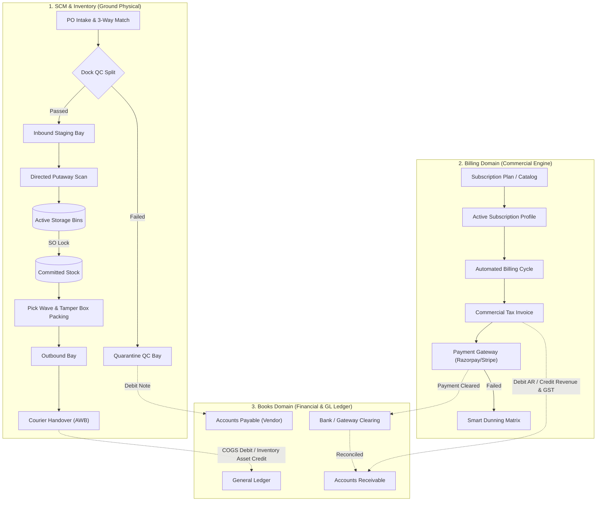

# 🏛️ End-to-End Enterprise ERP Master Business Logic Flow (Books ⟷ Billing ⟷ Inventory)

Yeh document **Books (Accounts)**, **Billing (Subscriptions & Monetization)**, aur **Inventory (Warehousing & Supply Chain)** ke beech ka **Complete Operational Flow** define karta hai.

Isme har ek lifecycle ka:
1. **Positive Flow (Happy Path)**: Standard ground operations kaise bina rukawat ke execute hoti hain.
2. **Negative Flow (Loopholes, Edge Cases, Fraud Locks & Blocks)**: Jahan operator galti kar sakta hai, chori ho sakti hai, ya system crash ho sakta hai, aur ERP ka standard business logic use kaise mathematically block karta hai.

---

## 🗺️ Master Cross-Domain Integration Architecture



---

## 🏛️ STANDARD BUSINESS LOGIC: "KYA HONA CHAHIYE" (STANDARD) VS "KYA HAI" (OUR CODE IMPLEMENTATION)

Neeche 10 Golden Pillars ka comparison hai jo prove karta hai ki standard business logic me jo hona chahiye, wahi code aur database me implement kiya gaya hai:

| # | Ground Pillar | Kya Hona Chahiye? (Industry Standard - SAP/Zuora/IFRS) | Kya Hai? (Hamare Code & DB Me Exact Implementation) |
|---|---|---|---|
| **1** | **Physical Stock Identity** | Stock kabhi ek single integer (`stock = 100`) nahi ho sakta. Maal hamesha physical godown buckets me batna chahiye. | **9 Physical Buckets + Double-Entry Stock Ledger**: `INBOUND_DOCK`, `QUARANTINE_QC`, `STORAGE_BINS`, `COMMITTED`, `PICKED_CART`, `PACKING_TABLE`, `OUTBOUND_BAY`, `IN_TRANSIT`, `SCRAP_BAY`. Har move ka audit record banta hai. |
| **2** | **ATP & Sales Gate** | Untested dock ka maal sales team nahi bech sakti. Jab tak rack bin me putaway confirm na ho, Available to Promise (ATP) zero rehna chahiye. | **$\text{ATP} = \text{Storage Bins} - \text{Committed}$**: Dock staging bay ka maal ATP formula se hard-excluded hai. Putaway task barcode scan par hi ATP unlock hota hai. |
| **3** | **Zero Overselling** | Sales order aate hi stock rack se nahi katna chahiye (maal wahi rakha hai), par doosra salesperson use na beche isliye reserve hona chahiye. | **Committed Stock Reservation**: SO confirm hote hi stock `COMMITTED` bucket me shift ho jata hai. ATP kam ho jata hai, par physical on-hand wahi rehta hai. |
| **4** | **Stock Derecognition & COGS** | Packing table par box sealed ho tab bhi company ka asset hai. Maal tabhi deduct hoga jab courier truck gate pass kare. Tabhi COGS debit hoga. | **AWB Courier Manifest Gate**: Dispatch confirm hote hi physical stock deduct hota hai, `COMMITTED` release hota hai, aur Books me `Debit: COGS / Credit: Inventory Asset` journal post hota hai. |
| **5** | **Dock Intake & Tolerance** | PO par 0 physical stock impact. Vendor over-delivery par strict cap (+5%). Defective maal par automated vendor debit note. | **Tolerance & QC Split**: PO par physical stock 0. Over-delivery > 5% par gatekeeper screen par `422 Unprocessable Entity` block. Defect units par `QUARANTINE_QC` routing + automated Debit Note. |
| **6** | **Revenue Recognition (ASC 606)**| 1 saal ka advance subscription aane par Day-1 profit nahi ban sakta. Deferred Revenue liability me jaayega aur monthly 1/12th amortize hoga. | **Deferred Revenue Engine**: Day-1 par amount `Deferred Revenue (Liability)` account me jata hai. Har mahine ki last date ko automated journal `Debit Deferred Revenue / Credit Realized Revenue` post karta hai. |
| **7** | **Proration & Mid-Cycle Changes**| Plan upgrade hone par customer se sirf remaining days ka delta charge hona chahiye, purane plan ka unused credit adjust hona chahiye. | **Exact Day Proration Engine**: Formula: $\text{Delta} = (\frac{\text{Days Left}}{\text{Total Days}} \times \text{New Rate}) - (\frac{\text{Days Left}}{\text{Total Days}} \times \text{Old Rate})$ calculate karke automated delta invoice banata hai. |
| **8** | **Smart Dunning & Collections** | Card fail hone par gateway ko loop me hit nahi karna (gateway suspend kar dega). Exponential backoff schedule follow hona chahiye. | **Exponential Dunning Matrix**: Retry strictly Day 0, Day 3 (banking off-peak), Day 7, Day 10 par hoti hai. Uske baad subscription status auto-turn `Suspended` ho jata hai. Zero gateway spam. |
| **9** | **Internal Theft & Shrinkage Gate**| Storekeeper chori chupane ke liye khud se stock ko damaged/write-off na kar sake. High value par executive sign-off mandatory ho. | **₹5,000 Approval Threshold**: Discrepancy > ₹5,000 hone par status `Pending Approval` me lock ho jata hai. Bina Senior VP Supply Chain & Finance Director digital approval ke stock deduct nahi ho sakta. |
| **10** | **Double-Entry Financial Invariance**| Kisi bhi transaction me Debits aur Credits mismatch nahi hone chahiye. Har financial movement auditable ho. | **Strict Accounting Invariance ($\sum \text{Debits} == \sum \text{Credits}$)**: Har transaction par balance sheet aur trial balance live tally rehta hai. |

---

---

# 🔄 LIFECYCLE FLOW 1: Procure-to-Pay (P2P) & Inbound Supply Gate

```
[Purchase Order (PO)] ➔ [Gate Entry Pass] ➔ [Dock Intake & 3-Way Match] ➔ [QC Line-Item Split] ➔ [Putaway to Bin] ➔ [Vendor Bill & Payment]
```

### ✅ Positive Flow (Happy Path)
1. **PO Generation (Books/Inventory)**:
   - Procurement manager approved vendor ke saath PO issue karta hai.
   - **Ground Rule**: Physical stock me **0 units aur ₹0** ka impact hota hai. Yeh sirf *Expected Incoming Supply* bucket me add hota hai.
2. **Truck Arrival & Gate Pass (Gate Inward)**:
   - Supplier ka truck dock par enter hota hai. Security guard PO number se vendor delivery challan match karke Gate Entry banata hai.
3. **Dock Intake (3-Way Matching)**:
   - Dock supervisor physical boxes count karta hai aur system me PO quantity ke saath match karta hai.
4. **Line-Item QC Split**:
   - 100 units aayi: 95 units ne QC standards pass kiye, 5 units defect nikli.
   - **Passed 95 units**: `INBOUND_DOCK` (Staging Bay) par move hoti hain.
   - **Failed 5 units**: Seedhe `QUARANTINE_QC` bay me move hoti hain aur vendor ke khilaf ₹14,000 ka automated **Vendor Debit Note** raise hota hai.
5. **Directed Putaway Execution**:
   - Forklift driver ke mobile scanner par Putaway Task generate hota hai (`BIN-RACK-B04`).
   - Driver bin ka barcode scan karke slotting confirm karta hai.
   - **ATP Activation**: Physical Bin scan hote hi **Available to Promise (ATP) 95 units unlock** ho jati hain.
6. **Financial Booking (Books)**:
   - Books me Vendor Bill generate hota hai:
     - `Debit: Inventory Asset A/c (₹2,66,000)`
     - `Debit: Input CGST/SGST A/c (₹47,880)`
     - `Credit: Accounts Payable - Vendor (₹3,13,880)`
   - Accounts team NEFT/RTGS se pay karti hai (TDS Section 194C cut karke).

---

### ❌ Negative Flow (Loopholes, Fraud & System Locks)

| # | Ground Loophole / Fraud Attack | Negative Scenario Kya Hoga? | ERP Standard Business Logic Lock |
|---|---|---|---|
| **1.1** | **Over-Delivery Vendor Fraud** | PO tha 100 units ka, vendor ne storekeeper se milkar 150 units bhej di taaki extra paise le sake. | **Over-delivery Tolerance Gate (+5% max)**: System maximum 105 units accept karega. Extra 45 units scan hote hi gate par `422 Unprocessable Entity` throw hoga aur truck gate se reject ho jayega. |
| **1.2** | **Dock-to-Sales Leakage** | Sales team ne dock par 100 units dekhi aur QC inspection hone se pehle hi customer ko bech di. | **Zero ATP at Dock Gate**: Inbound Dock aur Quarantine ka maal ATP me count hi nahi hota ($\text{ATP} = \text{Bins} - \text{Committed}$). Salesperson order karega toh system `Error: 0 units available for sale` dega. |
| **1.3** | **Damaged Stock Inventory Inflation** | QC inspector ne 5 defective units ko bina report kiye shelf par rakh diya. | **Physical Quarantine Bay Segregation**: Rejected stock system me `QUARANTINE_QC` bucket me lock rehta hai. Iska alag barcode hota hai jise putaway engine active sellable bin me slot karne se mana kar deta hai. |
| **1.4** | **Double Bill Payment Fraud** | Ek hi vendor invoice ko do baar enter karke double payment nikalna. | **Duplicate Invoice Reference Check**: Books domain vendor ke invoice number aur PAN/GSTIN ka unique composite index check karta hai. Repeat number par instant `409 Duplicate Vendor Invoice` error aata hai. |

---

# 🔄 LIFECYCLE FLOW 2: Order-to-Cash (O2C) & Outbound Fulfillment Gate

```
[Quote/Proposal] ➔ [Sales Order Confirmation] ➔ [Stock Commitment] ➔ [Pick & Pack] ➔ [Courier Dispatch] ➔ [Invoice & Payment]
```

### ✅ Positive Flow (Happy Path)
1. **Commercial Quote (Sales)**:
   - Sales representative client ko formal proposal bhejta hai with price, discounts, aur payment terms.
2. **1-Click Conversion to Sales Order**:
   - Client quote accept karta hai; 1-click se confirmed **Sales Order** ban jata hai.
3. **Automated Stock Commitment (Zero Overselling)**:
   - System ATP check karta hai ($\text{ATP} \ge \text{SO Qty}$).
   - Stock rack se nahi kat-ta, balki **`COMMITTED` bucket me lock** ho jata hai:
     $$\text{ATP} = \text{Physical On-Hand (50)} - \text{Committed (20)} = 30\text{ units}$$
   - Doosra salesperson use nahi bech sakta.
4. **Picking Wave & Cart Allocation**:
   - Warehouse worker trolley lekar bins me jata hai. Scanner bin barcode aur item SKU verify karta hai. Stock `PICKED_CART` bucket me shift hota hai.
5. **Packing Table & Tamper Barcode Sealing**:
   - Carton me packing hoti hai, gross weight scale par weigh hota hai, aur tamper-evident seal lagti hai. Stock `PACKING_TABLE` bucket me rehta hai.
6. **Courier Handover & Physical Derecognition (The Golden Gate)**:
   - BlueDart/Delhivery truck gate par aati hai. AWB Waybill Manifest scan hota hai.
   - Maal physically boundary se bahar nikalte hi:
     - Physical Stock On-Hand deduct hota hai (-20 units).
     - `COMMITTED` bucket release hoti hai (-20 units).
     - Books me General Ledger financial posting hoti hai:
       - `Debit: Cost of Goods Sold (COGS) A/c (₹60,000)`
       - `Credit: Inventory Asset A/c (₹60,000)`
7. **Commercial Tax Invoice & Revenue Booking**:
   - GST tax invoice client ko email hoti hai:
     - `Debit: Accounts Receivable - Customer (₹70,800)`
     - `Credit: Sales Revenue A/c (₹60,000)`
     - `Credit: Output GST Payable (₹10,800)`

---

### ❌ Negative Flow (Loopholes, Fraud & System Locks)

| # | Ground Loophole / Fraud Attack | Negative Scenario Kya Hoga? | ERP Standard Business Logic Lock |
|---|---|---|---|
| **2.1** | **The Phantom Negative Stock Disaster** | Shelf par 5 units hain, do salespeople ne ek sath 5-5 units ka order submit kiya, stock `-5` ho gaya. | **Atomic MongoDB Stock Reservation**: Decrement operation `{ stock: { $gte: reqQty } }` ke sath chalta hai. Pehli request pass hogi, doosri request ko instant rollback aur `409 Conflict: Insufficient physical stock` milega. |
| **2.2** | **Defaulting Customer Credit Breach** | Customer ka pehle se ₹10,00,000 overdue hai aur credit limit ₹5,00,000 hai. Sales rep ne commission ke chakkar me naya order approve kar diya. | **Hard Credit Limit Gate**: SO confirm hote waqt system `Customer.outstandingBalance + SO.total > Customer.creditLimit` check karta hai. Agar breach hua, toh SO auto-lock hokar `On Hold: Credit Limit Exceeded` me chala jata hai. |
| **2.3** | **Expired Goods Dispatch (Pharma/FMCG)** | Picker ne rack se wo batch utha liya jiski expiry aane wale 7 dino me hai. | **FEFO (First-Expired, First-Out) Hard Stop**: Picking engine warehouse worker ko sirf valid batch ka path dikhata hai. Agar operator expired batch scan karega, scanner red beeper dega aur dispatch manifest generate nahi hone dega. |
| **2.4** | **Unpacked / Lost in Transit Stealing** | Worker ne bola "Courier truck me daal diya", lekin truck aayi hi nahi thi aur maal chori ho gaya. | **Mandatory Courier AWB Integration**: Stock tab tak deduct nahi ho sakta jab tak third-party logistics API (Delhivery/BlueDart) se **Driver Handover Pickup Manifest Token** confirm na ho jaye. |

---

# 🔄 LIFECYCLE FLOW 3: Recurring-to-Revenue (R2R) & Hybrid Subscriptions

```
[Subscription Tier Defined] ➔ [Hybrid Checkout (SaaS + Hardware)] ➔ [Recurring Cycle Trigger] ➔ [Proration Engine] ➔ [Dunning & Collections]
```

### ✅ Positive Flow (Happy Path)
1. **Hybrid Subscription Model**:
   - Plan: *Apex Fleet Tracking System (₹2,500/month)*. Isme bundled hai:
     - 1 Physical GPS Tracker Unit (`goods`)
     - Monthly Cloud SaaS Software (`service`)
2. **Cross-Domain Activation**:
   - Customer checkout karta hai:
     - **Billing**: Recurring profile activate hoti hai (Repeat Every 1 Month).
     - **Inventory**: Pehli cycle par physical GPS tracker ke liye automated **Fulfillment Order** warehouse me chala jata hai.
3. **Monthly Automated Invoicing (Advance Billing)**:
   - Har mahine ki 1st date ko system automated tax invoice generate karta hai.
4. **Deferred Revenue Recognition (ASC 606 / IFRS 15)**:
   - Agar customer ne 1 saal ka advance pay kiya (₹30,000):
     - Day 1: Poora ₹30,000 **Deferred Revenue (Liability)** me credit hota hai.
     - Har mahine end par automated system journal entry:
       $$\text{Debit: Deferred Revenue (₹2,500)} \quad \longrightarrow \quad \text{Credit: Realized SaaS Revenue (₹2,500)}$$
5. **Gateway Auto-Charge**:
   - Razorpay/Stripe webhook se payment capture hote hi Books me Bank Clearing ledger reconcile ho jata hai.

---

### ❌ Negative Flow (Loopholes, Fraud & System Locks)

| # | Ground Loophole / Fraud Attack | Negative Scenario Kya Hoga? | ERP Standard Business Logic Lock |
|---|---|---|---|
| **3.1** | **Mid-Cycle Plan Hopping Gaming** | Customer ne high tier plan liya, features use kiye, aur 2 din baad cheap tier par downgrade karke poora refund maang liya. | **Proration Engine with Exact Day Matching**: System mathematically formula chalata hai: $\text{Refund} = \frac{\text{Days Left}}{\text{Total Days}} \times \text{Rate}$. Jitne din high plan active raha, utne din ka charge deduct hokar sirf bacha hua delta credit note banta hai. |
| **3.2** | **Zombie Card Retries (Gateway Ban Risk)**| Card fail hone par software har minute payment hit karega, jisse bank merchant account suspend kar dega. | **Exponential Smart Dunning Matrix**: Retry strictly Day 0, Day 3 (early morning 4 AM banking cycle), Day 7, Day 10 par hoti hai. Uske baad subscription status auto-turn `Suspended` ho jata hai. Zero gateway spam. |
| **3.3** | **Double Refund / Credit Application** | Customer ne ₹10,000 ka credit note Invoice A par bhi lagaya aur same time Invoice B par bhi apply kar diya. | **Atomic Remaining Balance Lock**: Credit Note ka `remainingBalance` field atomic transaction `{ remainingBalance: { $gte: applyAmount } }` se chalta hai. Ek paisa bhi double use nahi ho sakta. |

---

# 🔄 LIFECYCLE FLOW 4: Make-to-Stock (M2S) & Manufacturing / MRP

```
[BOM Definition] ➔ [MRP Netting Engine] ➔ [Work Order Release] ➔ [Shop Floor Kitting] ➔ [Final QC & Capitalization]
```

### ✅ Positive Flow (Happy Path)
1. **Bill of Materials (BOM) Setup**:
   - 1 Finished Good (Electric Scooter S1) banane ke liye chahiye:
     - 1 Chassis, 2 Wheels, 1 Battery Pack, 2m Wiring Cable (5% scrap factor).
2. **MRP Material Netting**:
   $$\text{Net Requirement} = \text{Demand (10)} + \text{Safety Stock (1)} - \text{On-Hand (2)} - \text{Incoming Supply (0)} = \mathbf{9\text{ units}}$$
   - System automatic purchase requisition aur shop-floor plan banata hai.
3. **Gate 1: Work Order Released**:
   - WO status `Planned` hota hai. Physical stock par **0 units impact**.
4. **Gate 2: Material Issue to Shop Floor**:
   - Warehouse se raw material nikal kar assembly floor par issue hota hai.
   - StockLedger double-entry: `ACTIVE_STORAGE_BINS ➔ WIP_SHOP_FLOOR`.
5. **Gate 3: Assembly & Final QC Inspection**:
   - Scooters assemble hue. QC inspector ne test ride aur electrical diagnostics pass kiye.
6. **Finished Good Capitalization**:
   - Raw material WIP consume ho jata hai.
   - Finished goods rack bin me active ho jate hain with standard cost roll-up:
     - `Debit: Finished Goods Inventory Asset A/c`
     - `Credit: Work-in-Progress (WIP) A/c`

---

### ❌ Negative Flow (Loopholes, Fraud & System Locks)

| # | Ground Loophole / Fraud Attack | Negative Scenario Kya Hoga? | ERP Standard Business Logic Lock |
|---|---|---|---|
| **4.1** | **Phantom Kitting (Starting WO without RM)** | Shop floor manager ne bina raw material ke production order release kar diya, aur workers baithe rahe. | **Hard BOM Availability Gate**: Work Order kitting tab tak complete nahi ho sakti jab tak storage bins me saare raw materials ka ATP verify na ho. Missing item hone par system `422 Missing Components` warning dega. |
| **4.2** | **Production Floor Scrap Cover-up** | Worker ne 5 battery packs short-circuit me jala diye aur unhe chupane ke liye fake finished goods entry daal di. | **BOM Yield Reconciliation**: Finished goods capitalization tabhi allow hoti hai jab input raw materials aur output finished goods ka ratio match kare. Extra material loss ko `SCRAP_BAY` me report karna padega with reason code. |

---

# 🔄 LIFECYCLE FLOW 5: Internal Controls, Auditing & Governance

```
[Move Orders] ➔ [Transfer Orders (In-Transit)] ➔ [Cycle Counts] ➔ [Shrinkage Approvals] ➔ [Period Locking]
```

### ✅ Positive Flow (Happy Path)
1. **Move Order (Bin-to-Bin Relocation)**:
   - Heavy items ko ground shelf `BIN-A1-01` se `BIN-B4-09` par move kiya gaya. Total stock `100 units` bilkul unchanged raha; double-entry stock ledger me location update hui.
2. **Inter-Warehouse Transfer (Hub A ➔ Hub B)**:
   - Gurugram hub se Bangalore hub 30 units bhejte waqt interstate truck me maal **`IN_TRANSIT`** bucket me lock raha. Dono hubs me se koi bhi use sell nahi kar saka. Bangalore dock par putaway hote hi Bangalore bins me add hua.
3. **Cycle Counting (Found Excess)**:
   - Routine count me 2 extra units mili. Valuation ₹2,000 thi (<= ₹5,000 threshold), auto-approved hokar bin me add ho gayi.

---

### ❌ Negative Flow (Loopholes, Fraud & System Locks)

| # | Ground Loophole / Fraud Attack | Negative Scenario Kya Hoga? | ERP Standard Business Logic Lock |
|---|---|---|---|
| **5.1** | **Internal Theft / Fake Shrinkage Write-off** | Warehouse manager ne ₹1,50,000 ke do laptop chori kiye aur system me "Damaged/Scrapped" daal kar bina kisi ko bataye stock se hata diya. | **Strict Approval Threshold (> ₹5,000)**: Har wo adjustment jiski value ₹5,000 se zyada hai, wo status `Pending Approval` me freeze ho jati hai. Jab tak **VP Supply Chain aur Finance Director** digitally approve nahi karte, physical stock se 1 unit bhi deduct nahi ho sakti. |
| **5.2** | **Backdated Accounting Manipulation** | Auditor ke aane se pehle purani closed balance sheet me tax chori ke liye purani invoice ka rate alter karna. | **Transaction Locking Engine**: Closed fiscal quarters par lock date lag jati hai. Agar koi user purani date ki invoice edit karne ki koshish karega, system instant `403 Forbidden: Financial Period Closed` dega. Ledger me sirf naye date ka Contra entry pass ho sakta hai. |
| **5.3** | **Truck Hijack / Transit Loss Fraud** | Transfer Order dispatch hua 30 units ka, lekin Bangalore dock par driver ne sirf 25 units utari aur 5 units gayab ho gayi. | **Transfer Intake Discrepancy Gate**: Destination dock par system driver challan aur physical count match karega. 5 missing units par system **Transit Loss Investigation Ticket** aur insurance claim ledger trigger karega. Bangalore stock me sirf 25 units hi add hongi. |

---

## 🎯 Master Operations Summary

| Operational Milestone | Positive Expected Result | Negative Prevention Mechanism |
|---|---|---|
| **PO Inward at Gate** | 3-Way match pass, stock staged | Over-delivery tolerance cap (+5%) |
| **Putaway to Rack Bin** | ATP unlocks only upon bin scan | 0 ATP at Dock (Zero selling of untested goods) |
| **Sales Order Booking** | Stock reserved in Committed bucket | Atomic decrement stops negative inventory |
| **Courier Handover** | COGS debited upon AWB manifest | Mandatory carrier pickup API verification |
| **Recurring Subscriptions** | Automated monthly tax invoice | Exponential backoff dunning stops gateway ban |
| **Credit Adjustments** | Unused credit applied to balance | Atomic remaining balance stops double refund |
| **Stock Discrepancy** | Cycle count reconciles physical bin | Value > ₹5,000 locks for senior executive approval |
| **Financial Auditing** | Real-time Trial Balance & Balance Sheet | Transaction locks stop backdated tax tampering |

---

# 📋 ALL-DOMAINS EXHAUSTIVE FEATURE VERIFICATION MATRIX

Neeche poori verification checklist di gayi hai jo confirm karti hai ki ERP ke teeno domains ka **ek bhi feature, ek bhi sub-module, aur ek bhi ground operation** chhoota nahi hai:

### 1. 📚 Books Domain (35 Features Covered)
- [x] **Items & Products Master**: Goods vs Services, Sales/Purchase rates, HSN/SAC, Tax rates
- [x] **Inventory Adjustments**: Quantity & value reconciliation, cost center allocations
- [x] **Customers Master**: Billing/shipping addresses, GSTIN/PAN, credit limits, payment terms
- [x] **Commercial Quotes**: Itemized pricing, discounts, custom validity, client acceptance
- [x] **Sales Orders**: SO confirmation, backorder flags, customer PO reference
- [x] **Tax Invoices**: GST tax invoices (CGST/SGST/IGST), TDS witholding, round-off, due dates
- [x] **Recurring Invoices**: Contract schedules, automated billing cycles, retainers
- [x] **Delivery Challans**: Supply on approval, job work dispatch, challan-to-invoice
- [x] **Payments Received**: Cash, cheque, bank transfer, excess advance ledger, TDS deductions
- [x] **Credit Notes**: Sales returns, price adjustments, invoice application, cash refunds
- [x] **Vendors Master**: Bank account details, MSME registration, TDS categories
- [x] **Direct Expenses**: Operational expenditures, tax claimable, paid through account
- [x] **Recurring Expenses**: Software subscriptions, office leases, recurring supplier bills
- [x] **Purchase Orders**: Vendor delivery schedules, commercial agreement, tolerance limits
- [x] **Vendor Bills**: AP liability booking, 3-way matching with PO & GRN
- [x] **Recurring Bills**: Retainers to suppliers, monthly utility liabilities
- [x] **Payments Made**: Vendor remittance, cheque prints, RTGS/NEFT UTR reference
- [x] **Vendor Credits**: Debit notes against returned goods, bill offsets
- [x] **Projects & Budgets**: Hourly billing vs fixed budget, cost vs revenue budgets
- [x] **Timesheets**: Employee logged hours, billable vs non-billable splits
- [x] **Bank Accounts**: Current, savings, petty cash, escrow accounts
- [x] **Bank Reconciliation**: Statement CSV import, automated matching rules
- [x] **Banking Rules**: Automated category assignments on bank import
- [x] **Manual Journals**: Multi-line Debit/Credit vouchers, accruals, depreciation
- [x] **Chart of Accounts (COA)**: 5-level hierarchical COA (Assets, Liabilities, Equity, Income, Expense)
- [x] **Budgets**: Fiscal year monthly expense budgets vs actuals
- [x] **Transaction Locking**: Period close audit locks preventing backdated tampering
- [x] **Fixed Assets**: Asset register, depreciation schedules, disposal logs
- [x] **Inter-Company Accounting**: Cross-entity transfers and due-to/due-from ledgers
- [x] **Financial Dimensions**: Cost centers, departments, projects, branches
- [x] **Fiscal Calendars**: Custom accounting calendar periods
- [x] **Tax Settings & Compliance**: GST rates, TDS tax slabs, GSTR-1 & GSTR-3B audit registers
- [x] **Treasury Forecasting**: Cash-flow runway projections
- [x] **Year-End Closing**: Closing revenue/expense into retained earnings
- [x] **Financial Statements**: P&L, Balance Sheet, Cash Flow, Trial Balance, General Ledger, AR/AP Aging

### 2. ⚡ Billing Domain (30 Features Covered)
- [x] **Subscription Plans**: Flat-fee, tiered pricing, volume tiers, freemium
- [x] **Add-ons & Metered Items**: Storage GB, API calls, user license overages
- [x] **Promo Coupons**: Percentage/fixed discounts, max redemptions, expiry limits
- [x] **Pricing Widgets**: Embeddable client pricing tables & checkout
- [x] **Item Catalog**: Services and hardware bundle items
- [x] **Subscriptions Engine**: Profile lifecycle (Trial, Active, Paused, Suspended, Cancelled)
- [x] **Mid-Cycle Upgrades/Downgrades**: Mathematical proration calculation engine
- [x] **Recurring Invoicing Engine**: Automated monthly invoice generation on cycle dates
- [x] **Quotes & Proposals**: Commercial proposals with 1-click conversion
- [x] **Credit Notes & Refunds**: SLA credits, gateway refunds, advance balances
- [x] **Payments Received**: Multi-channel collections, invoice allocation, receipts
- [x] **Payment Gateway Setup**: Razorpay, Zoho Payments, Stripe webhooks & tokenization
- [x] **Smart Dunning Matrix**: Exponential backoff retries on failed recurring card charges
- [x] **Customer Credit Balance**: Excess payments auto-credited to next month's invoice
- [x] **Client Projects**: Billing rates, labor budget vs revenue budget, realization rate
- [x] **Billable Timesheets**: Daily hours logging, 1-click invoice generation
- [x] **Operational Expenses**: Direct operating expenses
- [x] **Recurring Subscriptions**: Internal software/cloud subscriptions
- [x] **Lifecycle & Webhooks**: Real-time webhook listener and audit history
- [x] **MRR Waterfall Analytics**: New MRR, Expansion MRR, Contraction MRR, Churn MRR
- [x] **ARR Forecast**: Annual recurring revenue projection
- [x] **Churn Analysis**: Customer churn vs revenue churn
- [x] **Cohort Retention**: Month-by-month subscriber retention curves
- [x] **LTV / ARPU Reports**: Lifetime value and average revenue per user
- [x] **Trial Conversion Reports**: Free-to-paid conversion funnel
- [x] **Dunning Retries Analytics**: Recovery rate on failed card payments
- [x] **Receivables Summary**: Aging of subscription receivables
- [x] **Plan Performance**: Subscriber distribution by plan tier
- [x] **Add-on Consumption**: Usage metrics analytics
- [x] **Documents Vault**: Centralized subscriber document storage

### 3. 🏭 Inventory Domain (32 Features Covered)
- [x] **Items & Products Master**: Barcodes, dimensions, weight, preferred vendors
- [x] **Item Variants**: Multi-attribute matrices (Size, Color, Material, Voltage)
- [x] **Bill of Materials (BOM)**: Multi-level sub-assemblies, scrap percentages
- [x] **Multi-Warehouse Locations**: Zonal fulfillment centers, regional hubs
- [x] **9-Bucket State Machine**: Dock, QC, Bins, Committed, Cart, Packing, Outbound, In-Transit, Scrap
- [x] **Directed Putaway**: Dock-to-Rack barcode slotting; ATP unlocks strictly upon bin scan
- [x] **Move Orders**: Internal bin-to-bin relocation without changing company total stock
- [x] **Inter-Warehouse Transfer Orders**: Highway in-transit isolation between hubs
- [x] **Stock Adjustments & Shrinkage**: Threshold > ₹5,000 manager sign-off governance
- [x] **Purchase Orders**: Commercial agreement, expected incoming supply tracking
- [x] **Dock Inward & 3-Way Match**: Vendor challan vs physical boxes vs PO match
- [x] **Line-Item QC Split**: Accepted to Staging Dock vs Rejected to Quarantine Bay with Debit Note
- [x] **Sales Order Commitment**: Stock reserved in Committed bucket (Zero Overselling)
- [x] **Order Fulfillment Queue**: Automated picking wave routing based on batch availability
- [x] **Carton Packaging & Slips**: Box weight measurement, packing slips, tamper barcode seal
- [x] **Courier Dispatch (AWB Handover)**: Delhivery/BlueDart carrier handover, stock derecognition, COGS debit
- [x] **Delivery Challans**: Non-invoice physical goods transfer, job work, sample issue
- [x] **Sales Returns (RMA)**: Reverse logistics intake, QC triage (Restock to Bin vs Scrap Bay)
- [x] **Manufacturing Work Orders**: 3-Gate execution (Release ➔ RM Kitting to WIP ➔ FG Capitalization)
- [x] **MRP Material Netting**: Net Req = Demand + Safety Stock - OnHand - Supply
- [x] **Production Routings**: Multi-station assembly operations and standard times
- [x] **Machines & Work Centers**: Machine capacity, maintenance schedules, hourly machine rates
- [x] **FEFO / FIFO Batch Tracking**: First-Expired First-Out picking engine
- [x] **Serial Number Tracking**: Individual unit serial number tracking from receipt to dispatch
- [x] **Reorder Point Automation**: Minimum stock alerts and automated PR generation
- [x] **Safety Stock Buffers**: Buffer calculations to prevent stock-outs
- [x] **Inventory Valuation Engine**: FIFO and Weighted Average Cost (WAC) calculations
- [x] **ABC Classification**: High-value vs fast-moving inventory segmentation
- [x] **Slow/Fast Moving Analysis**: Aging and turnover velocity reports
- [x] **AI Supply Insights**: Anomaly detection on demand and supplier lead times
- [x] **Supply Chain Reports**: Stock valuation, stock ledger audit trail, transit reports
- [x] **Documents Vault**: Vendor compliance certificates and shipping documents

---
*End of Master Cross-Domain Enterprise ERP Flow.*

